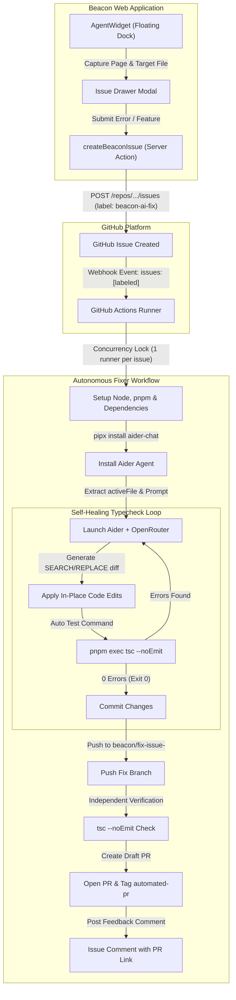
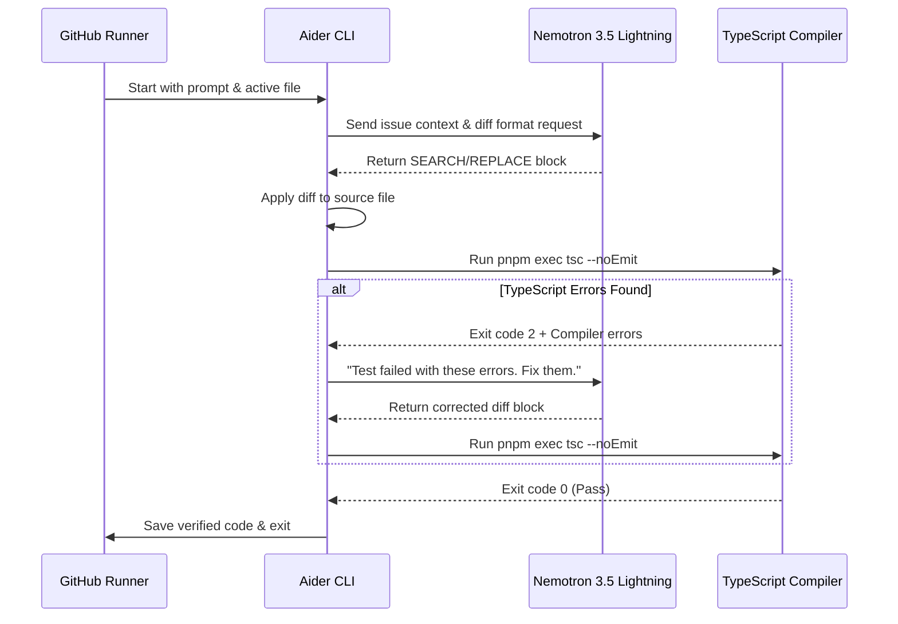

# Beacon Autonomous AI Fixer Architecture & Workflow

This document details the end-to-end architecture and operational lifecycle of Beacon's Autonomous AI Fixer. The system enables users to report bugs or request changes directly from the web application interface, automatically triggering an AI coding agent in GitHub Actions that writes targeted code diffs, validates TypeScript compilation in a self-healing loop, and delivers a draft pull request.

---

## 1. System Architecture Overview



---

## 2. Component Details

### A. UI Layer: Agent Dock & Issue Capture
- **Location:** `components/agent-dock.tsx` and `app/(workspace)/layout.tsx`
- **Behavior:**
  - Persistently mounted floating pill button in the bottom-right corner across all authenticated workspace routes.
  - Clicking the pill slides open a right-side Material UI Drawer (`PaperProps` modern slot pattern).
  - Automatically captures the current browser location (`contextPage`) and active source file (`activeFile`).
  - Provides a form for issue title and detailed bug description.

### B. Server Action: Metadata Packaging & GitHub Dispatch
- **Location:** `app/(workspace)/analyses/[id]/issue-actions.ts`
- **Behavior:**
  - Uses Octokit authenticated via `GITHUB_TOKEN`.
  - Injects machine-readable JSON metadata inside hidden HTML comments:
    ```markdown
    <!-- BEACON_METADATA_START
    {
      "version": 1,
      "hostRepository": "Mounieshh/beacon",
      "activeFile": "app/page.tsx",
      "contextPage": "/dashboard"
    }
    BEACON_METADATA_END -->
    ```
  - Attaches the trigger label `beacon-ai-fix` to the created issue.

### C. Workflow Dispatch & Concurrency Control
- **Location:** `.github/workflows/beacon-ai-fixer.yml`
- **Concurrency Guard:**
  ```yaml
  concurrency:
    group: beacon-fix-${{ github.event.issue.number || github.run_id }}
    cancel-in-progress: true
  ```
  Prevents duplicate workflow runs when multiple labels or edits occur.
- **Access Guard:** Restricts automated execution to repository owners, collaborators, and members.

---

## 3. Autonomous Repair Engine: Aider & OpenRouter

The workflow executes Aider (`aider-chat`) directly on the Ubuntu runner with the free OpenRouter model **NVIDIA Nemotron 3.5 Lightning** (`openrouter/nvidia/nemotron-3.5-lightning:free`).

### Key Engine Optimizations

| Flag | Purpose | Performance Impact |
| :--- | :--- | :--- |
| `--edit-format diff` | Enforces unified search/replace diff blocks rather than whole-file rewrites. | Reduces output tokens from 5,000+ to ~50, dropping execution time from 8m+ to ~2.5m. |
| `--file $ACTIVE_FILE` | Scopes Aider directly to the file extracted from the issue metadata. | Eliminates unnecessary codebase scans and prevents changes to unrelated files. |
| `--map-tokens 512` | Caps tree-sitter repository map overhead. | Minimizes initial prompt preparation latency. |
| `--cache-prompts` | Reuses prompt cache on supported OpenRouter endpoints. | Lowers input latency across multi-turn interactions. |
| `--auto-test` | Runs compiler check after each code change. | Enables autonomous self-healing. |
| `--test-cmd "pnpm exec tsc --noEmit"` | Specifies the exact TypeScript verification command. | Catches type, syntax, and import errors immediately. |
| `--yes-always` | Automatically accepts edits and commands. | Ensures non-interactive headless CI operation. |
| `--no-pretty`, `--no-stream`, `--no-analytics` | Disables TTY terminal escape codes and analytics pings. | Prevents non-TTY CI output freezes and buffer locks. |

---

## 4. The Self-Healing Build & Typecheck Loop



---

## 5. Verification & PR Delivery

1. **Commit Validation & Safety Guard:**
   The workflow checks whether the agent produced commits ahead of `origin/main` (`git rev-list --count origin/main..HEAD`).
   - If changes were made, the branch is pushed and verified with `pnpm exec tsc --noEmit`.
   - If no changes were produced (e.g., the model requested clarification or could not locate the component), the workflow cleanly skips PR creation, avoiding HTTP 422 errors. It reads the agent's response and posts it directly to the issue.
2. **Draft Pull Request Creation:**
   A GitHub Script step checks whether a PR already exists for branch `beacon/fix-issue-<number>`. If not, it opens a Draft PR against `main` containing:
   - Reference to the source issue (`Resolves #<id>`).
   - Summary of changes and model attribution.
   - Verification checklist.
   - Labels: `beacon-ai`, `automated-pr`.
3. **Issue Feedback Comment:**
   A comment is automatically added to the original issue linking the generated Draft PR.

---

## 6. Global Route Fallback Types

To support clean `tsc --noEmit` compilation on fresh CI checkouts without requiring a prior `.next` build, Next.js App Router props are declared as global fallbacks in `types/globals.d.ts`:

```typescript
declare global {
  type PageProps<T extends string = string> = {
    params: Promise<Record<string, string | string[] | undefined>>;
    searchParams?: Promise<Record<string, string | string[] | undefined>>;
  };

  type LayoutProps<T extends string = string> = {
    children: React.ReactNode;
    params?: Promise<Record<string, string | string[] | undefined>>;
  };
}
```
